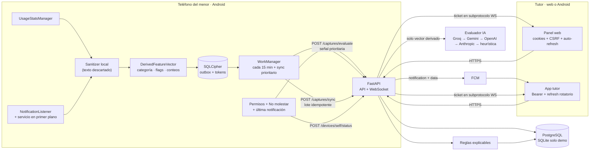

# IA Guardian


> **APK Android 1.7.16:** [descargar desde GitHub Releases](https://github.com/roninwuajkja/guardiania/releases/tag/v1.7.16) · [changelog](CHANGELOG.md)

Control parental para Android con **privacidad por diseño**: la conversación nunca sale del teléfono. El agente analiza localmente, descarta el texto y envía solo un vector de señales derivadas. El tutor recibe alertas explicables, no contenido.

> **Proyecto de Título — versión 1.7.16 (defensa).** Los datos de la demo son sintéticos. El motor de riesgo combina reglas explicables y una evaluación de IA que **solo recibe el vector derivado** (nunca texto); si no hay proveedor configurado, opera en modo heurístico. No es un diagnóstico ni reemplaza una conversación familiar. Antes de operar con datos reales de menores se requiere revisión legal chilena y auditoría de seguridad independiente; ver [`docs/compliance/compuerta-lanzamiento.md`](docs/compliance/compuerta-lanzamiento.md).

## Versiones

La versión actual es **1.7.16**. Las notas de cada versión y las APK anteriores están en [GitHub Releases](https://github.com/roninwuajkja/guardiania/releases); el historial completo está en [`CHANGELOG.md`](CHANGELOG.md).

## Qué incluye

- **Dos roles en Android:** panel del tutor (login, alertas, equipos, vinculación, ajustes) y agente del menor (captura local, permisos, estado, desvinculación protegida).
- **Panel web del tutor** servido por FastAPI, con cookies `httpOnly` + CSRF, autoactualización, exportación y eliminación de cuenta.
- **Vinculación con dos voluntades:** el tutor declara tutela y el menor otorga asentimiento. QR corto, código manual de 6 dígitos y confirmación en vivo por WebSocket.
- **Cuentas de tutor:** registro, verificación de correo, recuperación, cierre de sesiones, consentimientos versionados y auditoría.
- **Agente Android nativo** (Kotlin + Compose): uso de apps y metadatos de notificaciones, sanitización en memoria, cola offline con SQLCipher.
- **Motor de riesgo determinista** con evidencias: `self_harm`, `grooming`, `sextortion`, `abuse`, `trafficking`, `radicalization`, `sexual_content`, `sexual_harassment`, `violence`, `threat`, `weapons`, `coercion`, `bullying`, `hate_speech`, `insult_mild`, `insult_moderate`, `insult_severe`, `eating_disorder`, `doxxing`, `stalking`, `runaway`, `dangerous_challenge`, `drugs`, `gambling`, `malestar`, `scam`, `scam_points`, `scam_casino`, `scam_financial`, `scam_account`, `scam_link`, `scam_prize`, `scam_delivery`, `scam_job`, `scam_romance`, `unknown_contact`, `uso_nocturno`, `uso_prolongado`, `contacto_recurrente`.
- **Evaluación de IA** con el vector derivado (categoría, flags anonimizados, duración, conteos, hora local, notificaciones por minuto). Cadena Groq → Gemini → OpenAI → Anthropic → heurística local, con caché, circuit breaker y presupuesto de latencia.
- **Alertas en tiempo real y push:** WebSocket `/ws/tutor` con ticket efímero y FCM con `notification` + `data` para todas las severidades.
- **Backend FastAPI async** con PostgreSQL en producción y SQLite solo para demo local.
- **Sin analítica ni publicidad:** los únicos terceros opcionales son el proveedor de IA (solo vector) y FCM (alerta derivada); ambos se pueden desactivar.

## Arquitectura



Diagramas y contratos completos en [`docs/architecture.md`](docs/architecture.md). Decisiones de producto y privacidad en [`DESIGN.md`](DESIGN.md).

## Estructura

```text
.
├── backend/              API FastAPI, panel web, páginas legales y tests
│   ├── app/
│   │   ├── routers/      auth, pairing, captures, devices, account, panel, realtime, maintenance, ws
│   │   ├── services/     pairing, unlink, status, offline, captures, risk, evaluation,
│   │   │                 ai_evaluator, alerts, push, accounts, mail, retention, audit
│   │   ├── web/          consola del tutor (vanilla JS, fuentes locales)
│   │   ├── models.py     usuarios, sesiones, consentimientos, capturas, alertas, push_tokens
│   │   └── seed.py       demo sintética
│   └── tests/            integración, IA, push, seguridad y configuración de producción
├── android/              app Kotlin + Jetpack Compose (tutor y menor)
│   └── app/src/main/java/cl/guardiania/agent/
│       ├── capture/      Sanitizer, FeatureComposer, listener, servicio en primer plano, arranque
│       ├── data/         SQLCipher, Retrofit, sesión, refresh, estado de permisos, tutor
│       ├── notifications/ canales y notificaciones locales
│       ├── push/         registro FCM y servicio de mensajes
│       ├── realtime/     stream de alertas por WebSocket
│       ├── sync/         SyncEngine, HighRiskPolicy, WorkManager
│       └── ui/           role chooser, tutor, pairing, estado, diálogos, tema
├── docs/                 arquitectura, capturas, despliegue y cumplimiento
├── docker-compose.yml    PostgreSQL opcional para desarrollo
├── DESIGN.md             decisiones de producto, privacidad y sistema visual
└── PRODUCT.md            brief de producto
```

## Inicio rápido (demo local)

Requisitos: **Python 3.11+**, **JDK 17** y **Android SDK 35** para la app.

### 1. Backend y panel web

```powershell
cd backend
python -m venv .venv
.\.venv\Scripts\Activate.ps1
pip install -r requirements.txt
Copy-Item .env.example .env
.\.venv\Scripts\python.exe -m uvicorn app.main:app --reload
```

Abre <http://127.0.0.1:8000>. La base SQLite `backend/guardiania.db` y la demo se crean solas en el primer arranque.

| Campo | Valor |
| --- | --- |
| Correo | `demo@guardiania.cl` |
| Clave | `GuardianIA2026` |
| Menores | Sofía (12) y Matías (14) |

OpenAPI queda en <http://127.0.0.1:8000/docs> (solo en desarrollo) y el healthcheck en `GET /api/v1/health`.

### 1.1 Motor de IA (opcional)

La app funciona sin IA en la nube: sin clave responde la heurística local. Para probar el camino real, crea una clave gratuita en <https://console.groq.com/keys> (sin tarjeta) y déjala en `backend/.env`:

```env
GROQ_API_KEY=gsk_...
GROQ_MODEL=openai/gpt-oss-20b
GROQ_REASONING_EFFORT=low
AI_PROVIDER=groq
AI_PRIMARY_TIMEOUT_MS=2500
AI_FALLBACK_TIMEOUT_MS=450
AI_TOTAL_TIMEOUT_MS=3000
```

Verifica con vectores sintéticos:

```powershell
cd backend
.\.venv\Scripts\python.exe -m app.tools.verify_ai --provider groq --list-models
.\.venv\Scripts\python.exe -m app.tools.verify_ai --provider groq --repeat 5
```

**Límites del free tier (honestos):** ~30 req/min y ~1.000 req/día por modelo. Al agotarse responde `429` y el sistema degrada a heurística. Groq no entrena con los inputs por defecto; aun así, usa **solo vectores sintéticos o de demo** hasta firmar el DPA. El texto de las notificaciones sigue sin salir del teléfono.

### 2. App Android

```powershell
cd android
.\gradlew.bat :app:assembleDebug
adb install -r app\build\outputs\apk\debug\app-debug.apk
adb shell am start -n cl.guardiania.agent/.MainActivity
```

La app trae por defecto la URL de la demo desplegada. Para backend local:

- Emulador: `http://10.0.2.2:8000`.
- Teléfono por USB: `adb reverse tcp:8000 tcp:8000` y `http://127.0.0.1:8000`.
- Sin cable: IP LAN del computador y backend en `0.0.0.0`.

El tráfico HTTP en claro está bloqueado por `network_security_config`; la build release exige HTTPS. El APK release incluye solo `arm64-v8a`/`armeabi-v7a`; el build **debug** agrega `x86_64` para el emulador.

Detalles de permisos, SQLCipher, roles y pruebas en [`android/README.md`](android/README.md).

### 3. Vincular un menor

1. En el panel o en la app tutor, entra a **Vincular**, declara tu calidad legal y genera un QR o código.
2. En el teléfono del menor, elige **Este teléfono es del menor**, revisa qué señales se comparten y marca el asentimiento.
3. Escanea el QR o escribe los 6 dígitos.
4. El panel confirma en vivo y el teléfono pasa a la pantalla de estado.
5. Activa **Acceso de uso**, **Acceso a notificaciones** y **Batería sin restricciones**. En Samsung, agrega la app a **Apps que nunca se suspenden**.
6. Opcional: define un **código de desvinculación** en el panel y usa **Enviar señal de prueba** para verificar el flujo.

Estados de vinculación: `PENDIENTE`, `ACTIVO`, `REVOCADO`, `EXPIRADO`. Un código reutilizado responde 422 genérico; un QR reutilizado, 409. Un código **nuevo** del tutor revincula el mismo teléfono y revoca la vinculación anterior.

## API principal

| Método | Ruta | Uso |
| --- | --- | --- |
| `POST` | `/api/v1/auth/register` | Crea tutor y consentimientos |
| `POST` | `/api/v1/auth/login` | Login web/Android; devuelve tokens y cookies |
| `POST` | `/api/v1/auth/refresh` | Rotación atómica del refresh de tutor |
| `POST` | `/api/v1/auth/logout` | Revoca la sesión actual |
| `POST` | `/api/v1/auth/verify-email` | Consume token de verificación |
| `POST` | `/api/v1/auth/password/forgot` | Solicita enlace de recuperación |
| `POST` | `/api/v1/auth/password/reset` | Consume token y revoca sesiones |
| `POST` | `/api/v1/pairing/generate` | Crea sesión, QR corto, código y ticket WS |
| `POST` | `/api/v1/pairing/verify` | Vincula el teléfono con asentimiento |
| `POST` | `/api/v1/captures/sync` | Lote idempotente de vectores derivados |
| `POST` | `/api/v1/captures/evaluate` | Evalúa un vector con IA y despacha la alerta |
| `POST` | `/api/v1/devices/self/status` | Permisos, No molestar y última notificación |
| `POST` | `/api/v1/devices/self/unlink` | Desvincula con el código del tutor |
| `POST` | `/api/v1/devices/refresh` | Renueva el access token del teléfono |
| `GET` | `/api/v1/devices` | Inventario (excluye los ocultos) |
| `PUT/DELETE` | `/api/v1/devices/{binding}/unlink-code` | Define o quita el código de desvinculación |
| `POST` | `/api/v1/devices/{id}/hide` | Quita un desvinculado del panel |
| `POST` | `/api/v1/devices/hide-revoked` | Quita todos los desvinculados |
| `POST` | `/api/v1/devices/{id}/revoke` | Revoca una vinculación |
| `GET` | `/api/v1/overview` | Resumen del panel (con barrido de sin señal) |
| `GET` | `/api/v1/alerts` | Alertas explicables |
| `PATCH` | `/api/v1/alerts/{id}` | Marcar vista, reconocer o descartar |
| `POST` | `/api/v1/realtime/ticket` | Ticket efímero para el stream del tutor |
| `POST` | `/api/v1/push/tokens` | Registra/reasigna el token FCM del tutor |
| `GET` | `/api/v1/push/tokens` | Lista tokens sin exponer el valor |
| `POST` | `/api/v1/push/test` | Envía una push de prueba a los tokens del tutor |
| `POST` | `/api/v1/maintenance/sweep` | Barrido de sin señal para el pinger (clave) |
| `GET` | `/api/v1/account/export` | Exportación JSON de los datos del tutor |
| `POST` | `/api/v1/account/delete` | Eliminación con frase de confirmación |
| `WS` | `/ws/pairing/{session_id}` | Confirmación en vivo; ticket en subprotocolo |
| `WS` | `/ws/tutor` | Alertas en vivo; ticket `alerts:subscribe` |

## Seguridad y privacidad

- **Nunca** se persiste ni transmite el texto de una notificación. El `Sanitizer` lo usa en memoria y devuelve solo categoría y flags.
- El servidor rechaza campos extra en los vectores (`extra="forbid"`), como defensa contra PII accidental.
- El vector contiene categoría, minutos, conteos, flags, ventana temporal, `event_id` determinista, hora local y contexto de notificaciones. La IA recibe además `flags_detalle` con etiqueta, severidad y score de cada señal. `hashed_contact_id` existe en el contrato pero va `null`.
- **IA:** el proveedor externo recibe solo ese vector. No hay ruta que acepte texto y `AI_SEND_SNIPPET` está cerrado sin llamadores. La respuesta se valida como JSON estricto; si falla, se usa la heurística local y una red de seguridad determinista aplica el nivel mínimo por contexto.
- **Push:** FCM recibe `alert_id`, severidad, categoría legible, alias y el **resumen derivado**. No recibe texto, contactos ni contenido. El token FCM es del tutor, nunca del menor.
- **Desvinculación:** PIN de 6 dígitos con HMAC, 5 intentos y bloqueo de 15 min. No impide desinstalar la app, borrar datos desde Ajustes ni restablecer el teléfono: eso requiere *device owner* (MDM); el panel lo detecta y avisa.
- **Permisos:** el teléfono reporta notificaciones, uso, accesibilidad y No molestar. Si quitan el acceso a notificaciones, se genera una alerta ALTA; DND es contexto, no alarma.
- Los datos locales viven en SQLCipher; la frase se envuelve con una clave AES/GCM del Android Keystore.
- Web: cookies `httpOnly` (`SameSite=Lax`, `Secure` en producción), CSRF en métodos mutables, CSP sin `unsafe-inline` para scripts, `connect-src` limitado y estáticos versionados (`?v=`) con `Cache-Control: no-cache`.
- Android tutor: Bearer + refresh **rotatorio** con `Mutex`; web serializa refresh con `navigator.locks`.
- Pairing: declaración de tutoría y asentimiento obligatorios, código HMAC con pepper, máximo 5 intentos, ticket WS de 60 s fuera de la URL y del access log.
- Correo: enlaces en el **fragmento** de la URL; SMTP con TLS y validación de certificado.
- Operación: rate limit, límite de tamaño, cabeceras de seguridad, retención automática, auditoría sin contenido y configuración de producción **fail-closed**.

## Pruebas

```powershell
# Backend: 117 pruebas
cd backend
.\.venv\Scripts\python.exe -m pytest -q

# Android: 71 pruebas unitarias + 1 instrumentada (QR con ML Kit)
cd android
.\gradlew.bat :app:testDebugUnitTest
.\gradlew.bat :app:connectedDebugAndroidTest
```

Las pruebas backend cubren auth, pairing (incluida la revinculación), código de desvinculación y bloqueo, ocultar equipos, sin señal y reconexión, estado de permisos, IA con failover/caché/breaker, contratos Groq/Gemini, deduplicación, push (payload con notificación, contexto y token inválido), cuentas y configuración fail-closed. Android cubre sanitización, composición de vectores en bloques de 5 minutos, política de evaluación prioritaria, parsing de errores de desvinculación y decodificación de QR con ML Kit en dispositivo.

## Demo en la nube (gratuita)

La demo de la defensa corre sin PC: backend y panel en Render Free + PostgreSQL en Neon Free, con el teléfono como dispositivo del menor y una APK release firmada. URL: <https://guardiania-74l4.onrender.com>

Límites reales para decir en voz alta: Render duerme a los 15 minutos y tarda ~50 s en despertar; el plan free da 750 horas de instancia al mes y Neon 100 CU-horas. No se mantiene despierto 24/7: se abre el panel unos minutos antes de la demo y, si se usa un pinger, se programa solo para ese día. El detalle operativo, variables, FCM y checklist están en [`docs/despliegue-gratuito.md`](docs/despliegue-gratuito.md).

## Atlas de arquitectura

El atlas de 70 diagramas está publicado en <https://roninwuajkja.github.io/guardiania-atlas/>. Cada cambio actualiza los módulos afectados y se publica en `roninwuajkja/guardiania-atlas` con:

```powershell
.\scripts\publish-atlas.ps1
```

La regla completa y el alcance de lo que se versiona están en [`AGENTS.md`](AGENTS.md).

## Producción

El arranque en `ENVIRONMENT=production` **falla** si falta cualquiera de estas condiciones:

- HTTPS en `PUBLIC_BASE_URL`; PostgreSQL (no SQLite); `SEED_DEMO=false`.
- `JWT_PRIVATE_KEY_PEM` inyectada; peppers fuertes fuera del repositorio.
- `COOKIE_SECURE=true`, `CORS_ORIGINS` y `TRUSTED_HOSTS` explícitos.
- `DOCS_ENABLED=false`, `REQUIRE_EMAIL_VERIFICATION=true`, `EMAIL_DELIVERY=smtp`.
- SMTP con `SMTP_SSL` o `SMTP_STARTTLS` y validación de certificado.
- `AI_SEND_SNIPPET=false` y, si `FCM_ENABLED=true`, la credencial de Firebase presente.

FCM puede cargarse desde `FIREBASE_CREDENTIALS_JSON` (JSON o base64): el backend la escribe en `/tmp` al arrancar, porque Render Free no tiene disco persistente. La IA y FCM son opcionales; sin ellas funcionan la heurística y el WebSocket. Ver [`docs/firebase-setup.md`](docs/firebase-setup.md).

## Límites honestos

- **No es un diagnóstico clínico** ni un sistema certificado. Es una señal para conversar, no una prueba.
- **Cobertura:** el agente ve notificaciones y uso, no chats, fotos ni audio. Un contenido dañino sin notificación o fuera de las reglas locales puede no detectarse.
- **No se puede impedir** que el menor desinstale la app, borre sus datos o restablezca el teléfono sin MDM. Se detecta y se avisa.
- **No se puede impedir** que desactive notificaciones o active No molestar; se reporta el estado y se alerta si se pierde el acceso.
- **DND** no debería cegar al listener; el panel muestra “última notificación” para distinguirlo. Si un fabricante lo bloquea, queda el contexto de uso.
- **Push:** los fabricantes pueden retrasar la entrega en segundo plano; el servicio en primer plano y los ajustes de batería lo reducen, no lo eliminan.
- **Hosting free:** Render duerme y tiene 750 h/mes; el primer request tras inactividad tarda ~50 s.
- Faltan revisión legal, auditoría independiente, DPA y prueba en infraestructura real.

## Documentación

- [`DESIGN.md`](DESIGN.md) — arquitectura, privacidad, reglas de riesgo y sistema visual.
- [`CHANGELOG.md`](CHANGELOG.md) — cambios por versión y notas de la APK.
- [`docs/architecture.md`](docs/architecture.md) — diagramas y contratos de la base.
- [`docs/arquitectura-ia.md`](docs/arquitectura-ia.md) — IA, presupuesto de latencia, push, sin señal y permisos.
- [`docs/firebase-setup.md`](docs/firebase-setup.md) — configuración de FCM y diagnóstico.
- [`docs/despliegue-gratuito.md`](docs/despliegue-gratuito.md) — Render + Neon, variables, límites y checklist.
- [`android/README.md`](android/README.md) — build, permisos, roles y operación.
- [`docs/compliance/`](docs/compliance/README.md) — ROPA, DPIA, retención, incidentes y compuerta.
- [`PRODUCT.md`](PRODUCT.md) — brief de producto y principios.

---

Hecho en Chile. Interfaz en español de Chile; código e identificadores en inglés.
