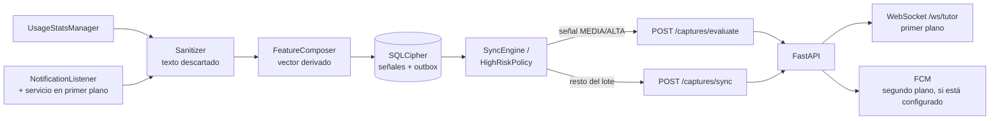

# App Android — IA Guardian

App nativa en Kotlin + Jetpack Compose con **dos roles**:

- **Tutor/a:** login y registro, resumen, alertas, dispositivos, generación de vinculación con declaración y asentimiento, ajustes completos de cuenta: cambio de contraseña, cierre en todos los dispositivos, historial de consentimientos, exportación (JSON compartible vía hoja del sistema) y reenvío de verificación de correo. Recibe alertas en vivo por WebSocket y, con Firebase configurado, notificaciones push con la app en segundo plano.
- **Teléfono del menor:** vinculación con asentimiento, permisos, captura local de señales, estado de sincronización y desvinculación.

El tutor también puede usar la consola web; ambos comparten la misma API.

## Requisitos

- JDK 17
- Android SDK 35 (`compileSdk`/`targetSdk`), `minSdk` 26 (Android 8.0)
- Android Studio Ladybug o superior, o Gradle 8.7
- API de IA Guardian accesible desde el teléfono/emulador

Versiones fijadas: AGP 8.6.0, Gradle 8.7, Kotlin 2.0.21, Compose BOM 2024.09.03, versión de app **1.5.0** (`versionCode` 6).

## Compilar e instalar

```powershell
cd android
.\gradlew.bat :app:assembleDebug
adb install -r app\build\outputs\apk\debug\app-debug.apk
adb shell am start -n cl.guardiania.agent/.MainActivity
```

El APK queda en `app/build/outputs/apk/debug/app-debug.apk`.

Si `adb` no está en el PATH:

```powershell
& "$env:LOCALAPPDATA\Android\Sdk\platform-tools\adb.exe" devices
```

## Conectar con el backend

| Entorno | URL en la app | Nota |
| --- | --- | --- |
| Emulador Android | `http://10.0.2.2:8000` | `10.0.2.2` es el host del emulador |
| Teléfono físico por USB (recomendado) | `http://127.0.0.1:8000` | `adb reverse tcp:8000 tcp:8000`; el backend no se expone a la LAN |
| Teléfono físico por Wi-Fi | `http://IP_LAN:8000` | Backend en `0.0.0.0`, ambos equipos en la misma red y firewall abierto |

Para el teléfono por USB, con la depuración activada:

```powershell
adb reverse tcp:8000 tcp:8000
adb reverse --list
```

El `reverse` se pierde al desconectar el cable o reiniciar `adb`; vuelve a ejecutarlo. La app del menor no necesita ninguna clave de IA: la clave vive solo en el backend.

El build **debug** permite HTTP en claro para desarrollo local. El build **release** usa `network_security_config` con `cleartextTrafficPermitted="false"`: solo HTTPS. No se aceptan certificados de usuario en release.

## Modo tutor

1. Abre la app y elige **Entrar**.
2. Escribe la dirección del panel, correo y contraseña. Si olvidaste la clave, **Recuperar contraseña** abre `/recuperar` en el navegador.
3. El refresh token rota y se guarda en SQLCipher; un `401` dispara un solo refresh con `Mutex`.
4. En **Equipos** puedes generar una vinculación: es obligatorio declarar la calidad legal de tutor antes de generar el QR/código. En cada equipo activo, **Definir código** permite crear, cambiar o quitar un PIN de 6 dígitos que el teléfono pedirá al desvincularse.
5. En **Ajustes**: datos de la cuenta, reenviar verificación si falta, **Seguridad** (cambiar contraseña — cierra todas las sesiones — y cerrar sesión en todos los dispositivos), **Mis datos** (exportar JSON y compartirlo con la hoja del sistema), documentos legales, historial de consentimientos, cambiar a modo menor o cerrar sesión. La eliminación definitiva de la cuenta queda en la consola web, con contraseña y frase de confirmación.

## Modo menor

1. En **Ajustes → Usar como dispositivo del menor**, confirma el cambio.
2. Revisa la explicación de qué señales se comparten.
3. Marca el asentimiento: *“Entiendo, junto a mi tutor/a, qué señales se comparten y acepto vincular este teléfono. Puedo pedir que se detenga.”* Sin esta marca, los botones de QR y código están deshabilitados.
4. Escanea el QR o escribe el código de 6 dígitos.
5. Acepta los tres accesos de la checklist.

También puedes automatizar los permisos en el emulador (solo desarrollo):

```powershell
adb shell appops set cl.guardiania.agent GET_USAGE_STATS allow
adb shell cmd notification allow_listener cl.guardiania.agent/.capture.GuardianNotificationListener
adb shell dumpsys deviceidle whitelist +cl.guardiania.agent

# Verificación
adb shell appops get cl.guardiania.agent GET_USAGE_STATS
adb shell settings get secure enabled_notification_listeners
```

La app vuelve a leer los permisos en `ON_RESUME`; no hace falta reiniciarla.

## Cómo funciona



- `Sanitizer` normaliza el texto (minúsculas, sin tildes) y aplica reglas léxicas. Devuelve solo `category` + `flags`.
- `FeatureComposer` agrupa por categoría y hora, calcula el vector y un `event_id` determinista (UUIDv5).
- `HighRiskPolicy` decide qué señales se evalúan una a una (máximo 5 por sincronización); el resto viaja en el lote.
- `SecureStore` guarda pairing, tokens, señales y metadata en SQLCipher. La cola se limita a 4.000 señales.
- `SecretVault` genera una frase aleatoria para SQLCipher y la cifra con una llave AES/GCM del Android Keystore.
- `DeviceSession` añade el Bearer, refresca una vez ante 401 y trata 410 como revocación.
- `TutorRepository` maneja login/registro, refresh rotatorio, ticket del stream y registro del token FCM.
- `SyncEngine` reintenta y borra solo lo aceptado/duplicado; `SyncWorker` lo ejecuta en segundo plano.
- `TutorAlertStream` mantiene el WebSocket del tutor solo en primer plano; `GuardianMessagingService` cubre el segundo plano.
- `StatusScreen` muestra permisos activos, pendientes, última sincronización, modo prueba, privacidad y desvincular.

## Privacidad y endurecimiento

- El texto de las notificaciones **no se escribe** en SQLCipher, ni en Logcat, ni en preferencias.
- El monitoreo base usa `NotificationListenerService` + `UsageStatsManager`. El `AccessibilityService` es **opcional, apagado por defecto y sin acceso a contenido** (`canRetrieveWindowContent="false"`): solo registra la categoría de la app en primer plano.
- Los tokens no viven en `SharedPreferences`; están dentro de la base cifrada. El token FCM del tutor es una credencial de entrega y se desactiva al cerrar sesión.
- El push no incluye narrativa ni texto: solo `alert_id`, severidad, categoría y alias.
- Al desvincular se borran los datos locales y se cancela el trabajo periódico.
- `allowBackup=false`, reglas de extracción de datos y `fullBackupContent` restrictivas.
- Release con R8, `shrinkResources` y sin cleartext. La firma se toma de variables de entorno; nunca se versiona un keystore.

Para firmar un release:

```powershell
$env:GUARDIANIA_KEYSTORE="C:\ruta\guardiania-release.jks"
$env:GUARDIANIA_KEYSTORE_PASSWORD="..."
$env:GUARDIANIA_KEY_ALIAS="guardiania"
$env:GUARDIANIA_KEY_PASSWORD="..."
.\gradlew.bat :app:assembleRelease
```

Sin esas variables, Gradle genera `app-release-unsigned.apk`; no lo distribuyas.

## Pruebas

```powershell
.\gradlew.bat :app:testDebugUnitTest
.\gradlew.bat :app:assembleRelease
```

- `SanitizerTest` (7): apuestas, autolesión con tildes, grooming, orden estable de flags, mensaje inocuo, paquete desconocido, notificación vacía.
- `FeatureComposerTest` (5): agrupación determinista, separación por hora, exclusión > 7 días, separación por categoría, vector de uso.
- `HighRiskPolicyTest` (3): vector benigno, todas las señales MEDIA/ALTA y combinación de señales.

Total: **15 pruebas unitarias**. Reportes en `app/build/reports/tests/testDebugUnitTest/index.html`.

## Firebase / notificaciones push

El push es **opcional**. Sin `android/app/google-services.json`, el plugin de
Google no se aplica y la app funciona con WebSocket y modo heurístico. Para
activarlo, sigue [`docs/firebase-setup.md`](../docs/firebase-setup.md):

1. Descarga `google-services.json` en `android/app/`.
2. Coloca la cuenta de servicio en `backend/secrets/firebase-service-account.json`.
3. Define `FCM_ENABLED=true` en `backend/.env` y reinicia el backend.
4. Acepta el permiso de notificaciones en el teléfono del tutor.

En Android 13+ la app pide `POST_NOTIFICATIONS` al iniciar sesión. El canal
`guardiania_alerts` usa importancia alta; el detalle siempre se consulta dentro
de la app autenticada.

## Solución de problemas

| Síntoma | Causa probable |
| --- | --- |
| “No encontramos el panel” | URL incorrecta o backend apagado; en emulador `10.0.2.2`, en teléfono por USB `127.0.0.1` con `adb reverse` |
| “Sin conexión con el panel” | Firewall, red distinta o HTTP bloqueado en release |
| El botón de vincular está deshabilitado | Falta marcar el asentimiento del menor |
| El panel no recibe la señal | Permiso de uso/notificaciones inactivo, o sync aún pendiente |
| La vinculación aparece revocada | El tutor revocó el dispositivo; vuelve a vincular |
| No hay señal de notificaciones | La app de origen no expone preview o el listener no está habilitado |
| No llega el push con la app cerrada | `FCM_ENABLED=false`, falta `google-services.json`, o el permiso de notificaciones está denegado |
| Aviso “isn’t 16 KB compatible” en Android 15/16 | La build actual no alinea `libsqlcipher.so` a páginas de 16 KB; puede fallar en dispositivos que usan ese tamaño de página. Requiere actualizar SQLCipher/NDK antes de publicar |
| El stream del tutor no conecta | Ticket vencido o backend sin la ruta `/ws/tutor`; vuelve a iniciar sesión |
| Error de SQLCipher al abrir | Datos de una instalación anterior con otra llave; borra datos de la app y vuelve a vincular |
| El refresh falla tras suspensión | Revisa reloj del equipo y conectividad; un 401 definitivo vuelve al login |

Para ver logs del agente sin exponer contenido:

```powershell
adb logcat -s GuardianIA SyncEngine GuardianWorker
```

No se registran títulos ni textos; si agregas logs, mantén esa regla.

## Límites

- No hay pinning TLS, Play Integrity obligatoria ni MFA.
- Algunos fabricantes restringen el trabajo en segundo plano; la checklist pide batería sin restricciones. Por eso el SLA de 3 s cubre evaluación → notificación, no el instante en que Android inicia el envío.
- La accesibilidad opcional no lee contenido; si el fabricante bloquea notificaciones, no hay una alternativa que capture texto (y no se implementará).
- La app no reemplaza una conversación familiar ni constituye diagnóstico.
- **No usar con datos reales de menores** hasta completar la compuerta de lanzamiento y la auditoría externa.
