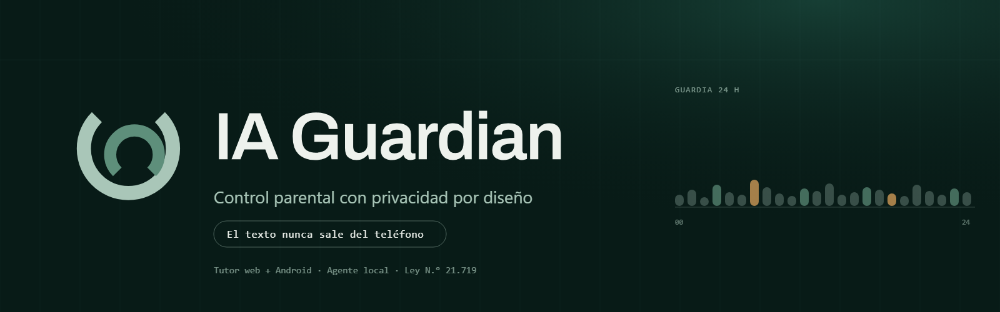

# Marca IA Guardian — Vínculo

**Vínculo** son dos órbitas que se cuidan y dejan un espacio libre. La abertura es la privacidad; el corte pequeño reemplaza la órbita interior por dos puntos para sobrevivir a 16 px.

## Archivos

- **Guía de marca:** [`GUIDELINES.md`](GUIDELINES.md)
- **Maestros SVG:** [`source/`](source/)
  - `b-vinculo-symbol.svg` — símbolo completo, una tinta.
  - `b-vinculo-symbol-color.svg` / `-reverse.svg` — color y reverso.
  - `b-vinculo-symbol-small.svg` / `-small-reverse.svg` — corte 16–32 px.
  - `b-vinculo-horizontal.svg` / `-small.svg` / `-color.svg` / `-reverse.svg` — lockups.
  - `b-vinculo-stacked.svg` / `-reverse.svg` — formato cuadrado.
  - `b-vinculo-wordmark.svg` — wordmark Archivo 600 en curvas.
- **Iconos web:** [`web-icons/`](web-icons/) — favicon, apple-touch, 192/512, maskable, manifest.
- **Banner:** [`banner/github-banner.png`](banner/github-banner.png) (1600 × 500) y [`banner/github-social-preview.png`](banner/github-social-preview.png) (1200 × 630).
- **Presentación:** [`presentation.html`](presentation.html) (5 diapositivas; abrir en navegador).
- **Brief y conceptos:** [`../docs/brand/`](../docs/brand/).

## Uso rápido

- App icon: símbolo completo sobre Pine 950.
- Favicon y marca de UI: corte pequeño.
- Banner y README: lockup horizontal reverso.
- Wordmark: nunca reescribir con otra fuente; usar el SVG en curvas.

La versión de marca se publica con IA Guardian **1.7.8**.
