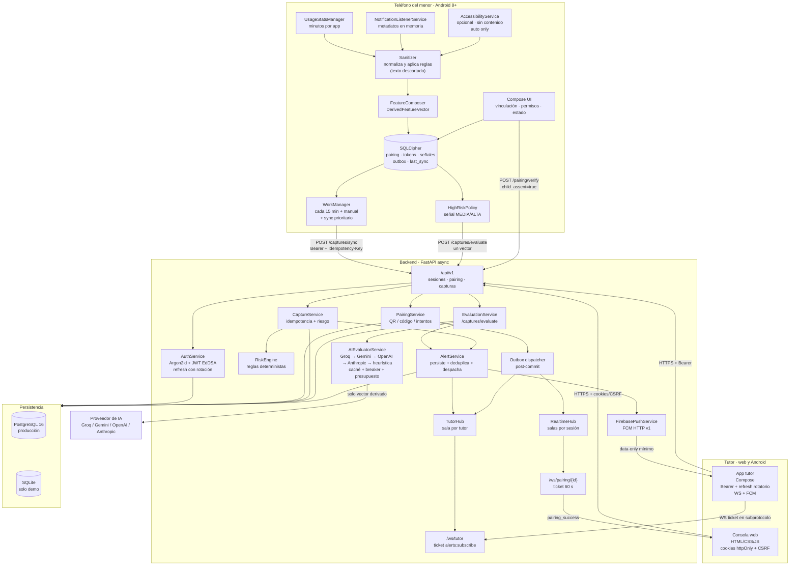
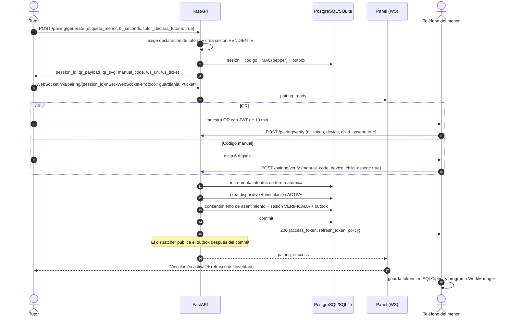
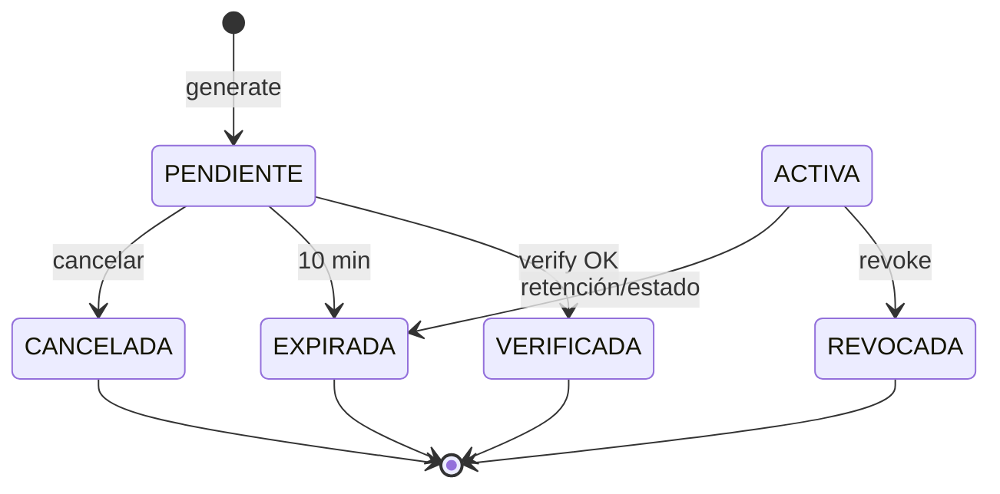
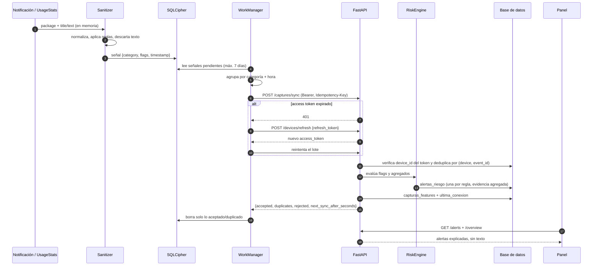

# Arquitectura y contratos

Este documento describe el flujo completo de IA Guardian y fija los contratos entre el agente Android, la app tutor, la API y la consola web. La fuente de verdad ejecutable es `backend/app/schemas.py`; OpenAPI queda disponible en `/docs` solo cuando `DOCS_ENABLED=true`.

> **Versión 1.4.0.** La base (identidad, vinculación, captura, retención y panel) se mantiene igual que en 1.1.0. El camino de evaluación con IA, el stream del tutor y el push FCM se detallan en [`arquitectura-ia.md`](arquitectura-ia.md).

## 1. Vista de componentes



**Propiedad clave:** el texto de una notificación vive únicamente en la memoria del `Sanitizer`. No se escribe en SQLCipher, no se registra en Logcat y no existe un campo para él en el contrato HTTP. El `AccessibilityService` es **opcional, apagado por defecto y sin acceso a contenido** (`canRetrieveWindowContent="false"`): solo aporta la categoría de la app en primer plano y nunca lee texto.

## 2. Roles y autenticación

### Tutor web

1. `POST /api/v1/auth/register` crea la cuenta y registra los consentimientos `terminos`, `privacidad` y `tutoria`.
2. Si `REQUIRE_EMAIL_VERIFICATION=true`, el registro responde `202` y envía un enlace. El token va en el **fragmento** (`/verificar-correo#token=...`), por lo que nunca llega al servidor ni al `Referer`.
3. `POST /api/v1/auth/login` devuelve tokens en el cuerpo y setea cookies `httpOnly`:
   - `guardiania_access`
   - `guardiania_refresh`
   - `guardiania_csrf` (legible por JS, no `httpOnly`)
4. Los métodos mutables autenticados por cookie exigen el header `X-CSRF-Token` con el valor de la cookie CSRF. Android usa `Authorization: Bearer`, que no depende de cookies.
5. `POST /api/v1/auth/refresh` rota el refresh token con **compare-and-swap atómico**: dos refreshes concurrentes no pueden rotar la misma sesión. El panel serializa refreshes con una promesa compartida y `navigator.locks`; Android usa un `Mutex`.
6. `POST /api/v1/auth/logout` revoca la sesión actual; `logout-all` y los cambios de contraseña revocan todas y suben `token_version`.

Cookies: `SameSite=Lax`, `Secure` en producción, `__Host-` cuando `COOKIE_SECURE=true`. La CSP permite scripts solo del mismo origen y `connect-src` únicamente al backend configurado.

### Tutor Android

Usa los mismos endpoints de auth, pero guarda `access_token` y `refresh_token` en SQLCipher. El refresh también rota. Un `401` dispara un único refresh protegido por `Mutex`; si falla, vuelve al login. No hay tokens en `SharedPreferences`.

### Dispositivo del menor

La vinculación emite un access token de dispositivo (15 min por defecto) y un refresh token de dispositivo (30 días). `POST /api/v1/devices/refresh` **no rota** el refresh: si se pierde la respuesta, el teléfono no queda bloqueado. La revocación desde el panel invalida ambos. Un `410` en sync significa que la vinculación fue revocada.

## 3. Secuencia de vinculación



Reglas:

- `tutor_declara_tutoria=true` es obligatorio para generar. `child_assent=true` es obligatorio para verificar.
- `PENDIENTE → VERIFICADA` al vincular; `PENDIENTE → EXPIRADA` a los 10 minutos; `PENDIENTE → CANCELADA` si el tutor la cancela. La UI muestra `ACTIVA` para la vinculación resultante.
- El código se guarda como `HMAC-SHA256(pepper, código)`; el índice único solo aplica a sesiones `PENDIENTE`.
- Máximo 5 intentos por sesión; el incremento ocurre antes de validar para evitar carreras.
- Un código reutilizado responde **422 genérico**. Un QR reutilizado responde **409**.
- El QR lleva `guardiania://pair?v=1&t=<uuid>.<hmac>`: 59 caracteres y **37×37 módulos**. Antes era un JWT de ~330 caracteres (89×89 módulos) y no se podía leer en una pantalla a distancia normal: verificado con ML Kit, zxing-cpp y OpenCV sobre una foto real del panel. El token corto es el id de sesión más un `HMAC-SHA256` truncado a 16 bytes con `PAIRING_PEPPER`; el JWT anterior se sigue aceptando para no romper QRs ya generados.
- Un código **nuevo** del tutor revincula el mismo teléfono: si el `install_id` ya tenía una vinculación `ACTIVA`, se revoca con sus tokens (`motivo_revocacion="Revinculación desde el mismo teléfono"`), se registra `binding_revoked` en el historial y se crea la nueva. Un `install_id` repetido no responde `409`: el tutor que emite el código es la autorización.
- El tutor puede definir un **código de desvinculación** de 6 dígitos por vinculación. El teléfono se desvincula con `POST /devices/self/unlink` y ese código (5 intentos, bloqueo de 15 min); el tutor revoca desde el panel sin código. **No impide** desinstalar la app, borrar los datos desde Ajustes ni restablecer el teléfono.
- Los dispositivos sin vinculación `ACTIVA` pueden **quitarse del panel** (`dispositivos_ocultos`): salen de la lista y de los contadores, pero sus alertas e historial se conservan.
- El ticket WS dura 60 s y viaja en `Sec-WebSocket-Protocol`, nunca en la query string. El servidor acepta el subprotocolo `guardiania` y rechaza con `4401` si el ticket falta o llega en la URL.
- El evento WebSocket se publica desde el outbox **después del commit**; un fallo de red no deja una vinculación fantasma.

En el teléfono, el QR se lee con **CameraX + ML Kit** usando el modelo empaquetado en el APK: no hay red ni descarga en el primer uso, y el contenido del QR no se registra en logs. El marco central es solo una guía visual; la detección usa el fotograma completo, así que el código se lee aunque quede algo descentrado. La actividad está fijada en retrato y cada fotograma se analiza en un hilo aparte (`STRATEGY_KEEP_ONLY_LATEST`).

### Estados



Una sola vinculación `ACTIVA` por dispositivo (índice único parcial). La sesión de vinculación y la vinculación son entidades distintas.

## 4. Secuencia de captura y sincronización



### Idempotencia

- `event_id` es un UUIDv5 determinista sobre `device_id + categoría + inicio de ventana + fin de ventana`.
- `capturas_features` tiene PK compuesta `(dispositivo_id, event_id)`; un reintento devuelve `duplicates` y no duplica alertas.
- `alertas_riesgo` tiene unicidad `(dispositivo_id, event_id, categoría)`.
- El agente elimina de la cola solo eventos aceptados o duplicados; los rechazados se descartan y se reportan.

### 4.1 Señales prioritarias (1.4.0)

`HighRiskPolicy` marca los vectores con flags MEDIA/ALTA. `SyncEngine` los envía uno a uno a `POST /captures/evaluate` (máximo 5 por sincronización) antes del lote; el resto sigue por `/captures/sync`. Si la evaluación individual falla por red o el backend responde error, el vector vuelve al lote y se aplican solo las reglas deterministas. La secuencia completa, el presupuesto de latencia y la degradación están en [`arquitectura-ia.md`](arquitectura-ia.md).

## 5. Contratos HTTP

### `POST /api/v1/pairing/generate`

```json
{
  "etiqueta_menor": "Antonia",
  "ttl_seconds": 600,
  "tutor_declara_tutoria": true
}
```

```json
{
  "session_id": "01fbcaac-245b-4ab8-9416-8e0d49a6cd72",
  "qr_payload": "eyJhbGciOiJFZERTQSIs...",
  "qr_svg": "<svg ...>",
  "manual_code": "679 361",
  "expires_at": "2026-10-22T16:29:12Z",
  "ws_url": "/ws/pairing/01fbcaac-245b-4ab8-9416-8e0d49a6cd72",
  "ws_ticket": "eyJhbGciOiJFZERTQSIs..."
}
```

### `WS /ws/pairing/{session_id}`

El cliente abre el socket con:

```text
Sec-WebSocket-Protocol: guardiania, <ws_ticket>
```

El servidor responde con el subprotocolo `guardiania`. No se acepta `?ticket=`. Eventos: `pairing_ready`, `pairing_success`, `pairing_expired`, `binding_revoked`, `ping`.

### `POST /api/v1/pairing/verify`

```json
{
  "manual_code": "679361",
  "device": {
    "platform": "ANDROID",
    "api_level": 35,
    "model_family": "sdk_gphone64_x86_64",
    "install_id": "9d8f4b7a-0f1b-4a4e-8f2a-7f2c1b8d3a11"
  },
  "child_assent": true
}
```

`qr_token` y `manual_code` son mutuamente excluyentes. `DeviceInfo` y los vectores usan `extra="forbid"`: cualquier campo no declarado produce 422.

Respuesta:

```json
{
  "status": "ACTIVO",
  "vinculacion_id": "0bca5fca-9eab-4a0a-a383-254c6c496499",
  "device_id": "ab17b101-a862-4fc2-84dd-21814e6d4c7d",
  "access_token": "eyJ...",
  "refresh_token": "r7...",
  "expires_in": 900,
  "tutor_alias": "Camila Rojas",
  "device_alias": "Antonia · sdk_gphone64_x86_64",
  "policy": {
    "retencion_dias": 90,
    "captura_texto": false,
    "categorias": ["social", "mensajeria", "video", "juegos", "navegacion", "educacion", "otras"]
  }
}
```

### `POST /api/v1/captures/sync`

Cabeceras: `Authorization: Bearer <access_token>` e `Idempotency-Key: <batch_id>`.

```json
{
  "schema_version": 1,
  "batch_id": "6d0f1f8e-5f9a-4a06-9c2e-2f6c1f0a7b11",
  "device_clock": "2026-10-22T16:19:17Z",
  "captures": [
    {
      "schema_version": 1,
      "event_id": "e2c1a7d4-6f1b-5a3e-9c8d-2b7a4e6f9c01",
      "device_id": "ab17b101-a862-4fc2-84dd-21814e6d4c7d",
      "time_window": {
        "start": "2026-10-22T16:00:00Z",
        "end": "2026-10-22T16:20:00Z",
        "tz_offset_minutes": -180
      },
      "category": "social",
      "lexical_flag_count": 1,
      "flags": ["gambling"],
      "hashed_contact_id": null,
      "usage_duration_minutes": 0,
      "notification_count": 3,
      "event_count": 3,
      "integrity": {
        "attestation_ok": true,
        "app_version": "1.4.0",
        "clock_skew_seconds": 0
      }
    }
  ]
}
```

```json
{
  "accepted": 1,
  "duplicates": 0,
  "rejected": [],
  "server_time": "2026-10-22T16:19:19Z",
  "clock_offset_seconds": 2,
  "next_sync_after_seconds": 900
}
```

Límites: 200 capturas por lote, ventana ≤ 60 min, `usage_duration_minutes` ≤ 1440, 16 flags como máximo y `lexical_flag_count >= len(flags)`. Una ventana inválida o un `device_id` distinto al del token se rechazan.

### `POST /api/v1/captures/evaluate`

Cabecera: `Authorization: Bearer <access_token>` de dispositivo. El cuerpo es **un** `DerivedFeatureVector` (mismo objeto que un elemento de `captures`), con `extra="forbid"`: no existe campo para texto. Límite de 120 evaluaciones por hora por dispositivo y por IP.

```json
{
  "schema_version": 1,
  "event_id": "e2c1a7d4-6f1b-5a3e-9c8d-2b7a4e6f9c01",
  "device_id": "ab17b101-a862-4fc2-84dd-21814e6d4c7d",
  "time_window": {
    "start": "2026-10-22T16:00:00Z",
    "end": "2026-10-22T16:20:00Z",
    "tz_offset_minutes": -180
  },
  "category": "mensajeria",
  "lexical_flag_count": 1,
  "flags": ["grooming"],
  "hashed_contact_id": null,
  "usage_duration_minutes": 0,
  "notification_count": 1,
  "event_count": 1,
  "integrity": { "attestation_ok": true, "app_version": "1.4.0", "clock_skew_seconds": 0 }
}
```

```json
{
  "event_id": "e2c1a7d4-6f1b-5a3e-9c8d-2b7a4e6f9c01",
  "evaluation": {
    "nivel_riesgo": "ALTO",
    "categoria": "Conducta_Riesgo",
    "descripcion_narrativa": "Solicitud de secreto y encuentro con un contacto no verificado.",
    "consejo_educativo": "Conversa con tu hija/o sobre encuentros con desconocidos y acuerden no compartir ubicación."
  },
  "alert_id": "4b8f1e2c-7d9a-4a51-b0f1-8e3c2a6d5b70",
  "severidad": "ALTA",
  "provider": "heuristic",
  "cached": false,
  "latency_ms": 312,
  "notified": true,
  "server_time": "2026-10-22T16:19:19Z"
}
```

- El vector se persiste igual que en el lote y la alerta se deduplica por `(dispositivo_id, event_id, categoría)`.
- `provider` indica quién respondió: `openai`, `anthropic`, `heuristic` o `cache`. Un fallo de proveedor **no** devuelve error: se usa la heurística.
- `latency_ms` mide el caso de uso completo en el servidor: normalización, llamada al proveedor (o caché/heurística), persistencia y despacho a WebSocket/FCM. No mide el tiempo hasta que el teléfono del tutor pinta el aviso; el SLA de 3 s presupone un dispositivo en línea y sin ahorro de batería agresivo.
- `notified` es `true` si la alerta se publicó en `/ws/tutor` o se encoló a FCM; no garantiza que el teléfono del tutor la haya mostrado.
- La narrativa y el consejo quedan en `alertas_riesgo` (`resumen`, `reglas`), nunca en el payload del push.

### `POST /api/v1/realtime/ticket`

Cabecera: `Authorization: Bearer <access_token>` de tutor.

```json
{
  "ws_url": "/ws/tutor",
  "ws_ticket": "eyJhbGciOiJFZERTQSIs...",
  "expires_in": 60
}
```

### `WS /ws/tutor`

El cliente abre el socket con el mismo esquema de subprotocolo:

```text
Sec-WebSocket-Protocol: guardiania, <ws_ticket>
```

Solo acepta tickets con scope `alerts:subscribe`; un ticket de vinculación responde `4403` y un ticket en query string responde `4401`. Eventos: `tutor_ready`, `risk_alert` y `ping` cada 25 s. El payload de `risk_alert` es mínimo:

```json
{
  "type": "risk_alert",
  "data": {
    "alert_id": "4b8f1e2c-7d9a-4a51-b0f1-8e3c2a6d5b70",
    "severidad": "ALTA",
    "categoria": "grooming",
    "device_alias": "Antonia · sdk_gphone64_x86_64",
    "ts": "2026-10-22T16:19:19Z"
  }
}
```

### Push FCM

| Ruta | Uso |
| --- | --- |
| `POST /api/v1/push/tokens` | Registra o reasigna el token FCM al tutor autenticado |
| `GET /api/v1/push/tokens` | Lista tokens activos sin exponer el valor |
| `POST /api/v1/push/tokens/unregister` | Desactiva un token al cerrar sesión |

El envío usa FCM HTTP v1 con payload **data-only**: `tipo`, `alert_id`, `severidad`, `categoria`, `device_alias`, `ts`. Sin narrativa ni contenido. Los tokens `UNREGISTERED`/`INVALID_ARGUMENT` se desactivan solos. Sin `FCM_ENABLED=true` y credenciales válidas, el push se omite y el WebSocket sigue funcionando.

### `POST /api/v1/devices/refresh`

```json
{ "refresh_token": "r7..." }
```

Devuelve un access token nuevo. El refresh de dispositivo **no rota**. Error `401` si el token no coincide o la vinculación no está activa; `410` en sync si fue revocada.

### Cuenta

| Ruta | Uso |
| --- | --- |
| `GET /api/v1/account/consents` | Historial de consentimientos |
| `POST /api/v1/account/consents` | Registra consentimiento/revocación versionada |
| `GET /api/v1/account/export` | JSON completo de tutor, dispositivos, vinculaciones, capturas y alertas |
| `POST /api/v1/account/delete` | Exige clave + frase `ELIMINAR MI CUENTA`; anonimiza y borra datos relacionados |

La exportación no incluye tokens, hashes de refresh ni contenido. La eliminación borra capturas, alertas, consentimientos, dispositivos, vinculaciones, sesiones, tokens y eventos outbox; anonimiza la fila de usuario y deja un evento `account.deleted` sin PII como prueba de supresión.

## 6. Modelo de datos

| Tabla | Propósito | Restricciones clave |
| --- | --- | --- |
| `usuarios` | Tutores y perfiles de menores | `rol`, credenciales solo para tutor, consentimiento |
| `seguridad_cuenta` | Verificación, bloqueo, versión de token | `token_version`, `email_verificado_en` |
| `sesiones_tutor` | Refresh de tutores | hash de refresh, revocación, expiración |
| `tokens_auth` | Verificación y reset | hash, propósito, un solo uso |
| `dispositivos` | Teléfonos vinculados | `fingerprint_hmac`, `refresh_token_hash`, estado |
| `sesiones_vinculacion` | Intentos de pairing | código HMAC único entre `PENDIENTE`, expiración e intentos |
| `vinculaciones` | Relación tutor–menor–dispositivo | una `ACTIVA` por dispositivo |
| `capturas_features` | Vectores derivados | PK `(dispositivo_id, event_id)` |
| `alertas_riesgo` | Alertas explicables | única por `(dispositivo_id, event_id, categoría)` |
| `consentimientos` | Tutoría, privacidad, términos, asentimiento | append-only, versión y fecha |
| `push_tokens` | Tokens FCM del tutor | único por `(usuario_id, token)`; activo/inactivo, sin valor en logs |
| `outbox_eventos` | Eventos post-commit | despacho al hub/WS |
| `auditoria` | Acciones de seguridad | hashes de IP/User-Agent, sin contenido |

No existe una tabla de mensajes, títulos, contactos ni contenido. El campo `hashed_contact_id` está previsto en el contrato, pero el agente 1.4.0 no lo calcula todavía: se envía `null` y la regla `contacto_recurrente` queda reservada, sin activarse.

## 7. Reglas de riesgo

El motor es determinista y explicable. Cada alerta guarda regla, severidad, evidencia agregada y ventana temporal; nunca el texto que la originó.

| Regla | Señal típica |
| --- | --- |
| `self_harm` | autolesión, plan suicida o despedida |
| `grooming` | secreto, aislamiento o solicitud de fotos |
| `sextortion` | chantaje con imágenes íntimas |
| `abuse` | abuso o maltrato en el entorno cercano |
| `trafficking` | trata, explotación o prostitución |
| `radicalization` | reclutamiento o supremacía violenta |
| `sexual_content` | términos sexuales explícitos |
| `violence` | amenazas, golpiza o pelea |
| `weapons` | armas o municiones |
| `coercion` | presión o chantaje |
| `bullying` | hostigamiento o exclusión |
| `hate_speech` | discurso de odio o discriminación |
| `eating_disorder` | conductas de trastorno alimentario |
| `doxxing` | exposición de datos personales |
| `runaway` | fuga o riesgo de desaparición |
| `dangerous_challenge` | retos virales peligrosos |
| `drugs` | sustancias, alcohol o vapeo |
| `gambling` | apuestas, casino o dinero |
| `malestar` | malestar emocional |
| `scam` | estafa o phishing |
| `unknown_contact` | contacto desconocido |
| `uso_nocturno` | uso en franja nocturna |
| `uso_prolongado` | duración anómala |
| `contacto_recurrente` | **reservada**; el agente 1.4.0 aún no envía hash de contacto |

En 1.4.0 convive con la evaluación de IA. Las reglas deterministas siguen siendo la base y el respaldo; la IA solo prioriza y redacta una explicación. Su salida se valida contra tres categorías (`Ciberbullying`, `Conducta_Riesgo`, `Contenido_Inapropiado`) más `Sin_Riesgo`, y cualquier respuesta fuera de ese contrato cae a la heurística. Ver [`arquitectura-ia.md`](arquitectura-ia.md).

Son señales para conversar, no pruebas ni diagnósticos. Los falsos positivos son posibles.

## 8. Errores y códigos

| Código | Situación | Uso |
| --- | --- | --- |
| `400` | Token de correo/reset inválido o expirado | La UI pide un enlace nuevo |
| `401` | Token ausente, inválido o expirado | El agente intenta refresh; si falla, pide re-vincular |
| `403` | Recurso de otro tutor, CSRF inválido o correo sin verificar | No se revela existencia |
| `409` | QR ya utilizado / conflicto de pairing | La UI pide generar uno nuevo |
| `410` | Vinculación revocada | El agente borra tokens y vuelve a vincular |
| `422` | Payload inválido, PII extra o código manual reutilizado | Mensaje genérico para códigos |
| `429` | Rate limit por IP/instalación | Reintento con backoff |

## 9. Seguridad operativa

- JWT **EdDSA (Ed25519)** con `kid`, `iss`, `aud`, `nbf`, `exp`, `jti`. En producción la llave privada se inyecta por entorno; en desarrollo se genera en `.data/keys/ed25519.pem`.
- Contraseñas con **Argon2id** (time_cost 3, memory 64 MB, parallelism 4).
- Web: cookies `httpOnly`/`SameSite`/`Secure`, CSRF, CSP, `nosniff`, `X-Frame-Options`, `Referrer-Policy` y límite de request.
- Android release: sin cleartext, R8/shrink, backup deshabilitado, tokens en SQLCipher, red solo HTTPS. La build debug permite HTTP local.
- Pairing: declaración de tutoría, asentimiento, HMAC con pepper, límite de intentos y ticket WS fuera de la URL.
- Correo: TLS con validación de certificado (`SMTP_SSL` o `STARTTLS` con `ssl.create_default_context`); enlaces en fragmento.
- Retención automática de capturas/alertas, tokens, sesiones, outbox y auditoría según `RETENTION_DAYS` y `AUDIT_RETENTION_DAYS`.
- IA: solo vector derivado, `AI_SEND_SNIPPET=false`, presupuesto de 1500 ms, caché por hash y circuit breaker por proveedor; las claves viven fuera del repositorio.
- Push: cuenta de servicio fuera del repositorio, payload data-only mínimo, tokens reasignados al tutor que inicia sesión y desactivados al cerrar sesión.
- Rate limit en memoria por proceso. Para escalar horizontalmente, moverlo a Redis o al balanceador.
- Producción **fail-closed**: rechaza SQLite, demo, HTTP, peppers de desarrollo, hosts comodín, docs abiertas, verificación de correo desactivada y SMTP sin TLS.
- HTTPS obligatorio en producción. El proxy debe sobrescribir `X-Forwarded-For` si `TRUST_PROXY_HEADERS=true`.

## 10. Límites conocidos y revisión externa

- No hay MFA, pinning TLS, Play Integrity obligatoria ni rotación automática de llaves.
- No hay backups/restauración probados ni monitoreo/on-call en este repositorio.
- El rate limit es local al proceso.
- La entrega SMTP real, la entrega de correo y la operación con datos reales no se probaron en infraestructura de producción.
- La IA se verificó contra Groq real con vectores sintéticos (`provider=groq`, JSON válido, P50 765–780 ms, P95 1000 ms con `openai/gpt-oss-20b`) y de punta a punta en emulador (`ai_eval provider=groq latency_ms=812`) y teléfono físico (`provider=groq`, 733 ms), con una sola alerta en cada uno. El camino con Gemini también se verificó (11,6 s). El free tier de Groq puede responder 429 al agotar cuota y el de Gemini limita a 20 peticiones/día por modelo; en ambos casos se usa la heurística. El push FCM sí se verificó end-to-end en un emulador con un proyecto Firebase real (token, `messages:send` 200, segundo plano, app cerrada y deep link a Alertas); falta probarlo con la app publicada.
- El SLA de 3 s cubre evaluación → notificación; el instante en que Android ejecuta el trabajo en segundo plano depende del fabricante y del ahorro de batería.
- **No está certificado** para datos reales de menores. Faltan revisión legal chilena, auditoría de seguridad independiente y DPA con encargados. Ver [`compliance/compuerta-lanzamiento.md`](compliance/compuerta-lanzamiento.md).
