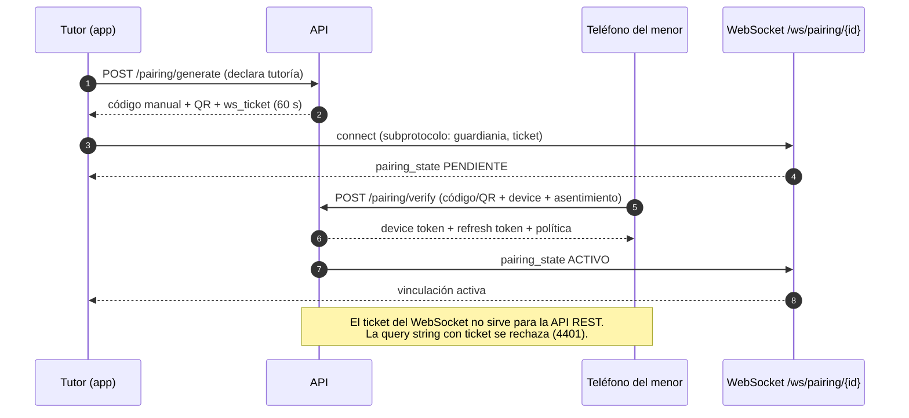
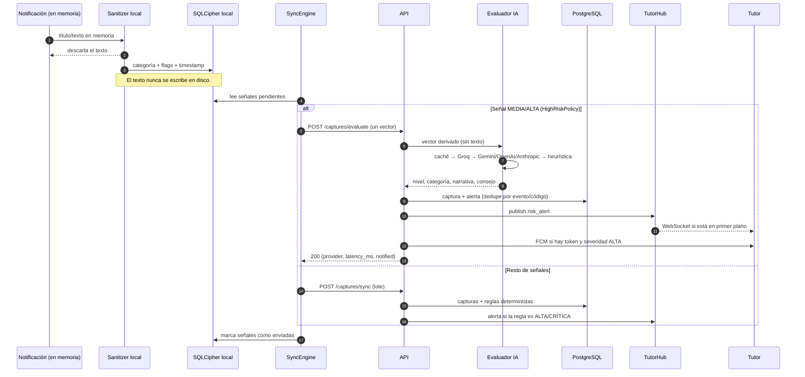
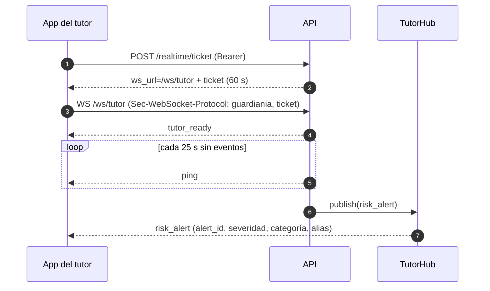

# Arquitectura de IA y notificaciones — IA Guardian 1.2.0

Este documento describe el camino completo de una señal: desde la vinculación del
teléfono del menor hasta la alerta que recibe el tutor. Complementa
[`architecture.md`](architecture.md), que cubre la base 1.1.0 (identidad,
almacenamiento, retención y panel).

## 1. Principios que no se negocian

1. **Regla Cero:** ningún texto, nombre, teléfono, foto, audio ni contenido de
   conversación sale del teléfono, se guarda en el servidor, se registra en
   auditoría o viaja en una notificación.
2. **El teléfono deriva, el servidor evalúa:** Android lee la notificación en
   memoria, aplica reglas locales y descarta el texto. Lo único que viaja es un
   `DerivedFeatureVector`.
3. **La nube de IA recibe solo el vector:** categoría de uso, flags léxicos
   anonimizados, duración, conteos y hora local. No hay ninguna ruta que acepte
   texto; `AI_SEND_SNIPPET` está cerrado y sin llamadores en 1.2.0.
4. **PostgreSQL es la fuente de verdad:** FCM y WebSocket solo transportan. Si
   el push falla, la alerta sigue disponible en el panel y en la auditoría.
5. **Degradación segura:** si todos los proveedores de IA fallan, una heurística
   local determinista responde igual. La captura nunca falla por la IA.

## 2. Componentes

| Componente | Ubicación | Rol |
|---|---|---|
| `GuardianNotificationListener` | Android | Lee avisos en memoria y los convierte en categoría + flags locales |
| `Sanitizer` | Android | Reglas léxicas locales; descarta el texto al terminar |
| `FeatureComposer` | Android | Agrupa señales en ventanas y produce `CaptureVector` |
| `HighRiskPolicy` | Android | Decide qué vectores se evalúan uno a uno |
| `SyncEngine` | Android | Evalúa señales de riesgo y sincroniza el resto en lote |
| `TutorAlertStream` | Android | WebSocket `/ws/tutor` con ticket efímero |
| `GuardianMessagingService` | Android | Recibe FCM y muestra la notificación local mínima |
| `AIEvaluatorService` | Backend | Groq → Gemini → OpenAI → Anthropic → heurística, caché y circuit breaker |
| `services/evaluation.py` | Backend | Caso de uso de `/captures/evaluate` |
| `services/alerts.py` | Backend | Persiste, deduplica y despacha al tutor |
| `FirebasePushService` | Backend | FCM HTTP v1 con JWT RS256 (sin `firebase-admin`) |
| `TutorHub` | Backend | Fan-out de alertas a las sesiones abiertas del tutor |

## 3. Vinculación tutor ↔ teléfono del menor

### Secuencia



### Diagrama ASCII

```
 Tutor                     API                        Menor
   |                        |                          |
   |-- generar (tutoría) -->|                          |
   |<-- código + QR ------- |                          |
   |== WS /ws/pairing ======|                          |
   |                        |<-- verificar + asiente --|
   |                        |--- binding ACTIVO ------>|
   |<== pairing_state ACTIVO|                          |
   |                        |                          |
```

Reglas de seguridad:

- El ticket viaja **solo** en `Sec-WebSocket-Protocol`, nunca en la URL.
- El ticket de vinculación (`pairing:subscribe`) no abre `/ws/tutor`, y el de
  alertas (`alerts:subscribe`) no abre la vinculación (4403).
- La sesión de vinculación expira y se cancela server-side; el agente local
  borra sus datos al desvincular.

> El **panel web** usa el mismo `/ws/tutor`: pide un ticket, escucha `risk_alert`
> y refresca el resumen cada 15 s (y al volver a la pestaña) como respaldo. Así
> las alertas, los contadores y el estado de los teléfonos aparecen sin recargar.
> También se publican las alertas de reglas MEDIA; el push FCM queda reservado a
> ALTA/CRITICA.

### Teléfono sin señal

Un teléfono que deja de sincronizar no revela la causa: puede ser internet,
batería, la app cerrada por el sistema o desinstalada. Tras
`OFFLINE_ALERT_MINUTES` (30 en la demo, 60 normal) se crea **una** alerta
`sin_senal` de severidad MEDIA por corte:

- `avisos_sin_senal` guarda la `ultima_conexion` ya avisada; un segundo barrido
  del mismo corte no repite.
- Al volver a sincronizar se borra la marca y se publica `device_reconnected`
  (aviso suave en panel y app del tutor).
- El barrido corre al abrir el panel, al abrir la app, en cada sincronización y
  en `POST /api/v1/maintenance/sweep` (protegido con `MAINTENANCE_KEY`).
- Un equipo recién vinculado tiene un margen igual al umbral para su primera
  sincronización.
- El texto es explícito: *«puede ser falta de internet, batería agotada o que la
  app fue desinstalada; no es posible distinguirlo desde el servidor»*.
- Con FCM configurado, el aviso llega aunque la app del tutor esté cerrada.

### Permisos y No molestar

Cada sincronización (y al conectar o desconectar el listener) el teléfono reporta
`notificaciones_activas`, `uso_activo`, `dnd` y `accesibilidad`. Si el acceso a
notificaciones se desactiva, se crea una alerta `acceso_desactivado` (ALTA, una
por episodio) y se cierra al reactivarlo con un evento `device_status`.

No molestar se muestra como contexto y **no** genera alerta: es normal de noche
o en clases. Si hay uso alto en una app social o de mensajería y cero
notificaciones, el vector viaja con `uso_sin_notificaciones` para que la IA
considere que las notificaciones pueden estar silenciadas.

El sistema Android no permite impedir estos cambios sin ser *device owner*
(MDM). La app no bloquea: **detecta y avisa** para que la guardia no parezca
completa cuando no lo está.

### Push en tiempo real

El push de alertas viaja como **`notification` + `data`**:

- El bloque `notification` lo pinta el sistema aunque la app esté cerrada; no
  necesita despertarla.
- El `data` lleva `alert_id`, severidad, categoría, alias y `open_alerts` para
  abrir la pestaña de alertas al tocar.
- Prioridad `high`, TTL de 5 minutos y canal `guardiania_alerts`.
- Con la app abierta, el WebSocket ya actualizó la lista; el sistema no muestra
  una segunda notificación.

`POST /api/v1/push/test` envía una push solo a los tokens del tutor autenticado y
responde `{enabled, sent, invalid, tokens}`. La app lo expone en Ajustes →
Notificaciones.

### Servicio en primer plano del menor

`GuardianForegroundService` mantiene vivo el proceso con una notificación
persistente de baja prioridad (“IA Guardian está activo”). Arranca al abrir la
app con una vinculación, al reiniciar el teléfono y al actualizar el APK; se
detiene al desvincular. Evita que el fabricante duerma el listener y retrase el
sync prioritario. En Samsung conviene sumar la app a “Apps que nunca se
suspenden”.

## 4. Captura → evaluación → alerta

### Secuencia



### Diagrama ASCII

```
Notificación ──► Sanitizer ──► SQLCipher          (texto descartado)
                                  │
                                  ▼
                            SyncEngine
                             │       │
               señal MEDIA/ALTA   resto
                             │       │
                             ▼       ▼
                 /captures/evaluate  /captures/sync
                             │       │
                             ▼       ▼
                       AIEvaluator  reglas deterministas
                             │       │
                             └───┬───┘
                                 ▼
                          PostgreSQL (verdad)
                                 │
                    ┌────────────┴────────────┐
                    ▼                         ▼
             TutorHub / WS              FCM HTTP v1
             (primer plano)         (segundo plano / cerrada)
```

### Por qué dos rutas

- `/captures/evaluate` evalúa **un** vector y puede producir una alerta con
  narrativa y consejo educativo. Se usa para las señales que importan ahora.
- `/captures/sync` conserva el contrato 1.1.0: valida el lote, persiste y aplica
  reglas deterministas. No llama a la nube de IA y sigue siendo el respaldo
  cuando la evaluación individual falla por red.

`HighRiskPolicy` limita a **5** las evaluaciones individuales por sincronización
para no agotar batería ni presupuesto. El resto viaja en el lote y se evalúa por
reglas.

## 5. Presupuesto de latencia

| Etapa | Presupuesto | Nota |
|---|---|---|
| Detección local | inmediata | reglas en memoria |
| Sync prioritario | variable | WorkManager; el sistema puede diferirlo por batería/cuota |
| Evaluación IA (producción) | ≤ 1500 ms | 1000 ms primario + 450 ms fallback + margen |
| Persistencia + commit | < 100 ms típico | SQLite local / PostgreSQL |
| Push al tutor | ≤ 1500 ms | tope de FCM; se ejecuta después del commit |
| **Evaluación → notificación (producción)** | **< 3 s** | objetivo medido en el backend |
| Evaluación IA (demo con Groq) | **P50 765–780 ms, P95 1000 ms** | `openai/gpt-oss-20b`, 8 mediciones |
| Evaluación IA (demo con Gemini) | 4–18 s observado | Gemini 3.5 Flash-Lite, 20 req/día por modelo |

El SLA de 3 s corresponde al perfil de producción con un proveedor de baja
latencia. **Groq sí lo cumple en la demo:** 8 de 8 evaluaciones con
`openai/gpt-oss-20b` respondieron JSON válido, con P95 de 1,0 s y presupuesto
`2500/450/3000 ms`. El free tier de Gemini, en cambio, no lo cumple (4–18 s y
20 req/día), así que queda solo como alternativa configurable. Si el proveedor
falla o se agota la cuota, la heurística responde igual y la captura no se
pierde.

El SLA de 3 s cubre **evaluación → notificación**, no el tiempo desde que el
menor recibe la notificación original. Android decide cuándo ejecuta el trabajo
en segundo plano y eso depende del fabricante, del ahorro de batería y de la
cuota de trabajos expeditos. El sistema pide sincronización prioritaria, pero no
puede garantizar el instante de inicio. Esta limitación es del sistema
operativo, no del backend.

### Degradación

```
            ┌──────────────┐  timeout/error   ┌──────────────────────────┐
vector ────►│    Groq      │─────────────────►│ Gemini / OpenAI / Anthropic│
            └──────┬───────┘                  └────────┬─────────────────┘
                   │ éxito                             │ éxito
                   ▼                                   ▼
              Assessment                          Assessment
                   │ todos fallan, 429/503 o breaker abierto
                   ▼
            ┌──────────────┐
            │  Heurística  │  determinista, sin red
            └──────────────┘
```

- **Caché** por hash del vector (5 min, 512 entradas): no guarda texto.
- **Circuit breaker** por proveedor: tras 3 fallos se salta el proveedor 60 s.
- Un fallo de proveedor **no** devuelve error al teléfono; se responde con la
  evaluación heurística y `provider="heuristic"`.

### Nivel mínimo por contexto

El prompt fija mínimos explícitos y, además, `apply_policy_floor` los vuelve a
aplicar después de la respuesta del modelo. Así una IA prudente en exceso no
"pierde" una señal real:

| Contexto del vector | Nivel mínimo |
|---|---|
| Autolesión, grooming, contenido sexual, violencia, presión/chantaje, acoso | ALTO |
| Cualquier otra señal (apuestas, drogas, malestar, contacto desconocido) | MEDIO |
| Dos o más señales distintas | ALTO |
| 20+ notificaciones por hora en app social/mensajería | MEDIO |
| Madrugada (00:00–05:59) con 8+ notificaciones | MEDIO |
| Sin señales y uso razonable | BAJO (sin alerta) |

Si el mínimo sube el nivel, el texto se reescribe con las señales detectadas y el
consejo de la regla correspondiente: la alerta nunca dice "sin riesgo" mientras
el vector tenga señales. El teléfono adelanta la evaluación (sin esperar el lote)
cuando hay señales, 20+ notificaciones en la ventana o actividad nocturna.

## 6. Entrega al tutor

### WebSocket (primer plano)



El stream se abre solo con la app en primer plano y se cierra en `ON_STOP`. Un
ticket vencido no reabre la conexión: el cliente pide uno nuevo.

### FCM (segundo plano o app cerrada)

- El backend firma un JWT RS256 con la cuenta de servicio y lo canjea por un
  access token OAuth2; luego hace `POST` a FCM HTTP v1.
- Payload máximo: `tipo`, `alert_id`, `severidad`, `categoria`, `device_alias`,
  `ts`. Sin narrativa, sin resumen, sin texto.
- El canal Android `guardiania_alerts` es de importancia alta; la notificación
  local muestra solo severidad y alias.
- Si el WebSocket está conectado, `GuardianMessagingService` no duplica la
  notificación.
- Los tokens `UNREGISTERED`/`INVALID_ARGUMENT` se desactivan solos.
- Al iniciar sesión otro tutor en el mismo teléfono, el token se reasigna para
  no filtrar alertas al tutor anterior.

## 7. Deduplicación

La clave efectiva es `(dispositivo_id, event_id, categoria)`:

- Las reglas deterministas usan el código de la regla (`bullying`, `self_harm`…).
- La IA usa el mismo código si hay un flag conocido; si no, `ai_<categoria>`.
- Reenviar el mismo vector no crea una segunda alerta ni vuelve a notificar.

## 8. Qué se guarda y qué nunca se guarda

| Dato | ¿Se guarda? | Dónde |
|---|---|---|
| Categoría de app, minutos, conteos, flags, ventana | Sí | SQLCipher local + PostgreSQL |
| `event_id`, `device_id`, severidad, score | Sí | PostgreSQL |
| Narrativa y consejo educativo de la IA | Sí (≤ 280 caracteres) | `alertas_riesgo.resumen` y `reglas` |
| Token FCM del tutor | Sí | `push_tokens` (credencial, no dato del menor) |
| Texto de la notificación original | **No** | — |
| Nombres, teléfonos, fotos, audio, mensajes | **No** | — |
| Token FCM en logs | **No** | solo huella SHA-256 truncada |
| Texto o narrativa en el payload FCM | **No** | — |

`hashed_contact_id` sigue **reservado** y va `null` en 1.2.0. La regla
`contacto_recurrente` no se activa.

## 9. Configuración relevante

```env
AI_ENABLED=true
AI_SEND_SNIPPET=false          # obligatorio; sin llamadores en 1.2.0
AI_PROVIDER=auto               # auto | groq | gemini | openai | anthropic | heuristic
AI_PRIMARY_TIMEOUT_MS=2500     # demo medida con Groq
AI_FALLBACK_TIMEOUT_MS=450
AI_TOTAL_TIMEOUT_MS=3000
AI_CACHE_TTL_SECONDS=300
AI_BREAKER_FAILURES=3

# Groq (API compatible con OpenAI, JSON schema estricto y reasoning_effort)
GROQ_API_KEY=                  # sin clave → siguiente proveedor o heurística
GROQ_MODEL=openai/gpt-oss-20b
GROQ_BASE_URL=https://api.groq.com/openai/v1
GROQ_REASONING_EFFORT=low      # low | medium | high | vacío

# Google Gemini (API nativa, JSON schema, clave en header x-goog-api-key)
GEMINI_API_KEY=                # alternativa configurable
GEMINI_MODEL=gemini-3.5-flash-lite
GEMINI_BASE_URL=https://generativelanguage.googleapis.com/v1beta
GEMINI_THINKING_LEVEL=minimal  # alternativa a GEMINI_THINKING_BUDGET

OPENAI_API_KEY=                # proveedor alternativo opcional
ANTHROPIC_API_KEY=             # proveedor alternativo opcional

FCM_ENABLED=false              # true solo con la cuenta de servicio presente
FCM_TIMEOUT_MS=1500
ANDROID_PACKAGE_NAME=cl.guardiania.agent
```

Producción exige además PostgreSQL, TLS, verificación de correo y
`AI_SEND_SNIPPET=false`; el arranque falla si esas condiciones no se cumplen.

## 10. Límites honestos de 1.2.0

- No es un diagnóstico clínico ni un sistema certificado. Es una señal para que
  un adulto converse, no una prueba.
- La heurística y las reglas léxicas pueden dar falsos positivos y falsos
  negativos; ninguna evaluación reemplaza la conversación familiar.
- Sin claves de proveedor, el sistema opera solo con heurística local.
- **Free tier de Groq:** alrededor de 30 req/min y 1.000 req/día por modelo,
  con 8K TPM y 200K TPD; los valores exactos se confirman en la consola y con
  `verify_ai --list-models`. Al agotarse responde `429` y la captura degrada a
  heurística.
- **Datos en Groq:** por defecto no retiene la inferencia ni entrena con
  inputs/outputs; conserva metadatos de uso y puede retener datos hasta 30 días
  para diagnosticar fallos o abuso. Aun así, la clave gratuita es **solo para
  demo con vectores sintéticos** hasta firmar el DPA.
- **Free tier de Gemini:** 20 peticiones por día **por modelo** y por proyecto.
  Al agotarse responde `429 RESOURCE_EXHAUSTED`; cuando hay congestión responde
  `503 UNAVAILABLE`. Ambos casos degradan a heurística, no rompen la captura.
- **Datos en free tier de Gemini:** Google puede usar las peticiones para
  mejorar sus productos. Por eso la clave gratuita es **solo para demo con
  vectores sintéticos**; no debe usarse con menores reales ni datos de terceros.
  La Regla Cero sigue intacta (no viaja texto), pero el vector derivado sí sale
  del servidor.
- **Latencia:** Groq es estable (P95 1,0 s medido) y cumple el SLA de 3 s con el
  presupuesto actual. Gemini sigue siendo variable (4–18 s) y no sirve como
  fallback dentro de 450 ms. Para producción se requiere un proveedor con DPA
  firmado, o un modelo local.
- El push depende de Google FCM y de la configuración del fabricante.
- La revisión legal chilena y la auditoría de seguridad independiente siguen
  siendo requisitos de lanzamiento, no algo que este documento certifique.

### Estado de verificación al 2026-10-28

- **FCM y WebSocket del tutor:** verificados end-to-end en emulador
  `Pixel_8_Pro_API_35` con un proyecto Firebase real. Evidencia observada:
  token FCM registrado, `messages:send` HTTP 200, alerta dibujada por el
  WebSocket sin aviso local duplicado, notificación en segundo plano, proceso
  despertado tras `am kill` y apertura de **Alertas** al tocar el aviso.
- **IA en la nube (Groq, camino principal):** `GroqProvider` verificado contra
  la API real. `--list-models` confirmó 11 modelos disponibles, incluido
  `openai/gpt-oss-20b`. Con `--repeat 5` y luego `--repeat 3`: **8/8
  evaluaciones** con `provider=groq`, JSON válido, P50 765–780 ms y P95 1000 ms,
  sin degradaciones. La cuota, la caché, el circuit breaker y el presupuesto se
  validaron además con proveedores simulados y **74 pruebas automatizadas**.
- **IA en la nube (Gemini, alternativa):** `GeminiProvider` verificado contra la
  API real con un vector sintético: `provider=gemini`, JSON válido y 14,2 s con
  `gemini-3.5-flash-lite`. La cuota free tier de `gemini-3.5/3.6-flash` se agotó
  durante las pruebas (20 req/día); `gemini-3.8-flash` respondió `503` por
  capacidad. Queda configurable, no como camino principal.
- **Camino completo en emulador (Groq):** el agente `Emulador IA`
  (`Pixel_8_Pro_API_35`) envió una señal de prueba con los permisos de uso y
  notificaciones activos. El backend llamó a
  `https://api.groq.com/openai/v1/chat/completions` (HTTP 200) y registró
  `ai_eval provider=groq level=MEDIO cached=false latency_ms=812`. El panel del
  tutor mostró **una sola** alerta con `provider=groq`, nivel `MEDIO`, categoría
  `Conducta_Riesgo` y la narrativa/consejo generados. No hubo duplicados y el
  teléfono no envió texto.
- **Camino completo en emulador (Gemini, histórico):** la misma prueba con
  Gemini registró `ai_eval provider=gemini latency_ms=11641` y una única alerta
  con `provider=gemini`.
- **Teléfono físico (Samsung SM-S948B, Android 16):** vinculación con código,
  `adb reverse tcp:8000 tcp:8000`, permisos de uso, notificaciones y batería
  activos. La señal de prueba llegó al backend y **Groq respondió `HTTP 200` en
  733 ms** (`ai_eval provider=groq level=MEDIO latency_ms=733`), con una única
  alerta persistida con `provider=groq`, nivel `MEDIO` y narrativa en español.
  No hubo duplicados ni capturas repetidas. La prueba anterior con Gemini había
  respondido en 11,5 s y 16,3 s y su alerta quedó en heurística por el
  presupuesto de entonces. El teléfono mostró además el aviso de Android sobre
  librerías nativas no alineadas a páginas de 16 KB (`libsqlcipher.so`).
- **Pendiente:** más hardware físico (gama media/baja), app publicada en Play
  Store y revisión legal/auditoría independiente. La prueba en el teléfono
  personal requiere conectarlo por USB con `adb reverse tcp:8000 tcp:8000`.
